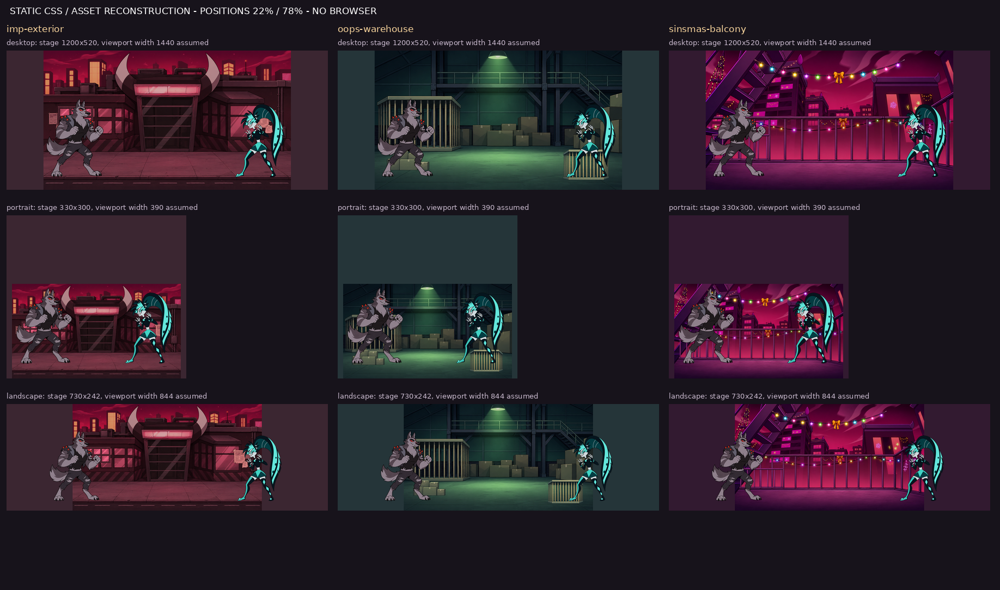

# Vague F — personnages, décors et effets

Cette livraison poursuit la PR #8 depuis `3be94943f5315bbe8e7af996ff6ac7f8678a2fa3`. Elle apporte **25 dessins retenus**, conservés sous forme de 25 masters PNG et 25 exports WebP sans perte, plus trois miniatures dérivées : **53 fichiers d’image de production**. Les images de diagnostic de QA sont comptées séparément.

## Personnages : treize poses

| Personnage | Nouvelles poses | État jouable |
| --- | --- | --- |
| Vortex | Repos, garde, frappe légère, recul | Nouveau kit standalone, portrait READY, trois duels originaux |
| Glitz | Repos, garde, frappe légère, recul | Nouveau kit standalone, portrait READY, trois duels originaux |
| Glam | Repos, garde, recul | Nouveau kit standalone ; frappe dédiée absente après refus |
| Alastor | Garde, recul | Kit et repos existants conservés ; frappe dédiée absente après refus |

Les trois nouveaux kits possèdent les trois actions ordinaires du moteur. Les histoires et règles de combat sont des créations Simulation AU. Les finitions réemploient l’effet rideau existant, sans nouvelle illustration de finition. Les actions non redessinées utilisent le repli sur les poses disponibles : ces clés ne constituent pas des cycles complets d’animation.

Les rapports natifs largeur/hauteur sont conservés. Les appuis sont mesurés sur le bas visible de l’alpha, puis intégrés dans le registre des ancres. Les contrôles de fichier et les compositions statiques ne certifient pas les tailles canoniques relatives ni les transitions exécutées.

## Décors : trois fonds et six éléments indépendants

| Arène | Fond | Éléments séparés |
| --- | --- | --- |
| I.M.P. · Façade extérieure | Façade de l’immeuble, rue et accès | Bloc de fenêtres ; affiches murales |
| Entrepôt · Oops | Entrepôt industriel et stockage | Groupe de caisses ; cage vide |
| Balcon de Blitzø · Sinsmas | Balcon nocturne et décorations | Garde-corps ; guirlande multicolore |

Chaque fond de 1672 × 941 reste entier en `contain`, aligné en bas. Les props détourés de 1254 × 1254 utilisent le repère du fond contenu et leurs marges alpha. La cage et les autres props restent derrière les combattants. Les trois arènes disposent d’une partition procédurale originale.

Neuf compositions statiques bureau, portrait et paysage ont été inspectées aux positions de départ 22 % / 78 %. À décalage de parallax nul, les 18 boîtes visibles de props restent dans l’image de fond. Les bandes de couleur dues aux ratios divergents sont conservées ; en paysage, les silhouettes peuvent déborder partiellement sur elles. Sans unités de conteneur, le fond complet reste visible et les props additionnels sont masqués.

## Effets : trois images, quatre associations

| Effet | Association dans le jeu |
| --- | --- |
| Flèche rose-violette de Velvette | Coup lourd et spécial |
| Lasso de Striker | Spécial ; le tir lourd existant est conservé |
| Fumée de Valentino | Spécial |

Ces images habillent les attaques existantes et suivent leur temps de simulation. Elles n’ajoutent ni projectile physique autonome, ni collision, ni portée, ni dégâts, ni statut. L’inventaire de préchargement, l’audit et la bible incluent la variante de Striker.

## Couverture après livraison

| Indicateur | Avant F | Après F |
| --- | ---: | ---: |
| Combattants | 40 | 43 |
| Repos individuels | 37 | 40 |
| Gardes distinctes | 13 | 17 |
| Contacts légers individuels | 15 | 17 |
| Réactions individuelles | 14 | 18 |
| Arènes à trois plans | 22 | 25 |
| Images VFX | 11 | 14 |
| Associations attaque–VFX | 24 | 28 |
| Références de fichiers en jeu | 377 | 408 |
| Références manquantes | 0 | 0 |

Le standalone compte 25 personnages Hazbin et 18 Helluva, 43 routes / 129 duels et 133 attaques paramétrées dont quatre signatures. Les six costumes / 35 poses alternatives et les 26 affectations illustrées / 22 dessins narratifs restent inchangés. Le manager conserve ses huit arènes.

## Validation réelle

- `npm run qa` a réussi avant le dernier ajustement CSS : TypeScript, ESLint, **44 suites / 376 tests**, deux builds et contrôle du standalone.
- Après le réalignement CSS, les deux builds ont été relancés avec succès et **989 empreintes du standalone** ont été vérifiées. Une tentative intermédiaire de build a été interrompue par la mémoire disponible ; la relance isolée a réussi.
- L’audit trouve **408 références présentes, zéro manquante**. Les 25 exports WebP de production ont les mêmes pixels décodés que leurs masters. Les miniatures sont des réductions proportionnelles distinctes.
- La bible a été régénérée : **23 feuilles, 209 formules et caches sans erreur, 5 870 cellules V2 comparées au runtime**, onze feuilles historiques identiques à l’octet et en valeurs décodées. Quatre vues du classeur ont été rendues et inspectées.
- Revue indépendante des registres, des sources et des adaptations AU ; `git diff --check` sans erreur.

Le navigateur n’a pas pu être lancé : Chromium échoue avant création de page avec `socket() EPERM`, et la revue automatique a rejeté la demande de permissions supplémentaires. Aucune capture de partie, interaction navigateur, console ou réponse HTTP réussie n’est revendiquée. Les détails et les contrôles statiques figurent dans [la revue visuelle](REVIEW_ASSETS_WAVE_F_2026-11-24.md).

## Limites de fidélité et reste à produire

Les sources officielles, références secondaires, prompts et adaptations sont enregistrés séparément. **La fidélité 1:1 reste l’objectif de comparaison, elle n’est pas certifiée par cette livraison.** Les mises en scène, poses de combat et trajectoires d’effets sont des adaptations pour le jeu.

Les frappes d’Alastor et de Glam ont été refusées ; aucun export fictif ni nouvelle tentative après refus. Les anciens PNG de la vague E n’ont pas été retrouvés. Vassago, Wally Wackford, Barbie Wire et les poses complémentaires de Husk restent au registre des manques. Les trois décors et la garde d’Alastor de F sont de nouvelles générations, pas une récupération de E. Le contenu Dragon Ball hors périmètre reste exclu.

## Registres

- [Manifeste F et empreintes de production](../../art/infernal-versus/production/delivery-wave-f-2026-11-24.json)
- [Personnages](../../art/infernal-versus/production/characters-wave-f-2026-11-24.json), [décors](../../art/infernal-versus/production/stages-wave-f-2026-11-24.json), [VFX](../../art/infernal-versus/production/projectiles-wave-f-2026-11-24.json)
- [QA automatisée](QA_RUNTIME_WAVE_F_2026-11-24.json), [QA du classeur](QA_WORKBOOK_WAVE_F_2026-11-24.json)
- [Bible de production](INFERNAL_VERSUS_BIBLE_V2.xlsx), [couverture des assets](ASSET_COVERAGE.json)
