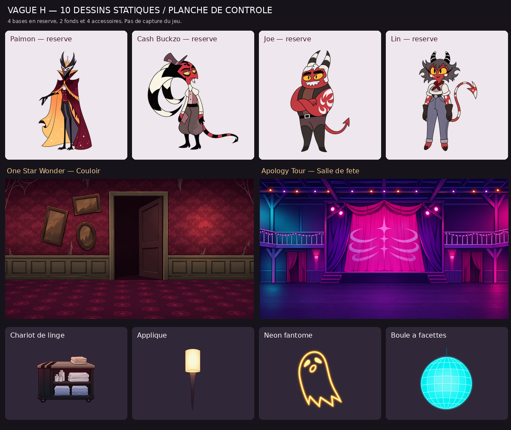

# Livraison H — 25 novembre 2026

## Résultat

**10 nouveaux dessins statiques et 22 fichiers d’image de production** complètent les éléments manquants. Cette vague prolonge la [PR nº 8](https://github.com/darknigthmare/hellbound-hotel-manager/pull/8) après la publication vérifiée de G au commit [`9995ec7`](https://github.com/darknigthmare/hellbound-hotel-manager/commit/9995ec777cda4feca47a547ca6233d3db6f42d82).

| Contenu H | Dessins | Mise à disposition |
| --- | ---: | --- |
| Paimon, Cash Buckzo, Joe et Lin | 4 | Bases neutres avec transparence, en réserve |
| One Star Wonder · Couloir | 1 | Nouvelle arène sélectionnable |
| Apology Tour · Salle de fête | 1 | Nouvelle arène sélectionnable |
| Chariot de linge et applique | 2 | Calques séparés du couloir |
| Néon fantôme et boule à facettes cyan | 2 | Calques séparés de la salle de fête |
| **Total** | **10** | **10 PNG + 10 WebP sans perte + 2 miniatures** |

Une image est fournie par asset. Aucun cycle d’animation, pose d’attaque, kit de combat ou nouvelle affectation de projectile n’est ajouté. Les deux arènes réemploient des partitions originales existantes.

## État du jeu et des réserves

| Indicateur | Après G | Après H |
| --- | ---: | ---: |
| Combattants jouables | 43 | 43 |
| Arènes à trois plans | 28 | **30** |
| Références actives présentes | 420 | **428** |
| Références actives manquantes | 0 | **0** |
| Bases de personnages en réserve | 5 | **9** |
| Bases d’ennemis en réserve | 6 | **6** |
| Projectiles en réserve | 1 | **1** |
| Fichiers de réserve présents | 24 | **32** |
| Images VFX actives / associations aux attaques | 14 / 28 | 14 / 28 |

Le [catalogue cumulatif](../../art/infernal-versus/production/reserve-assets.json) réunit les bases et le projectile de G et H. Les fichiers datés de G restent conservés. L’audit et le classeur lisent ce catalogue cumulatif, avec une étiquette de vague pour chaque base. Une base en réserve n’est pas un combattant jouable.

La fiche de suivi `human-beach` renvoie maintenant à `spring-broken-beach`, déjà livré en G ; elle ne déclenche plus la production d’un fond en doublon. Son projet de créature géante reste non réalisé.

## Production cumulée de la PR

| Lot tracé | Dessins | Fichiers d’image de production |
| --- | ---: | ---: |
| Premier lot | 42 | 86 |
| C | 35 | 73 |
| D | 26 | 55 |
| F | 25 | 53 |
| G | 21 | 45 |
| H | 10 | 22 |
| **Total** | **159** | **334** |

Ce cumul comprend 159 masters PNG, 159 exports WebP et 16 miniatures. Les treize images de contrôle H sont exclues de ce total. Les lots G et H représentent ensemble **31 dessins et 67 fichiers de production** depuis le précédent HEAD F.

## Vérifications

### Images et intégration

- **10/10 masters** conservés à l’octet et **10/10 exports WebP** identiques aux pixels sources.
- **8/8 silhouettes transparentes** entières au seuil alpha 16, sans contour significatif coupé au bord du canevas.
- **428 références actives et 32 fichiers de réserve présents**, aucune référence manquante.
- **6 compositions statiques** des arènes, pour trois formats chacune ; **12/12 placements d’accessoires** contenus dans l’illustration, en calcul exact et raster.
- Relecture indépendante du registre, du CSS, de l’audit et du builder : aucun défaut bloquant identifié.

### Projet

TypeScript, ESLint et **44 suites / 376 tests** passent. La première commande `npm run qa` s’arrête ensuite sur `ENOSPC` pendant la copie des assets du build web. Le nettoyage porte uniquement sur les sorties de compilation ignorées du projet.

Sans changement des sources du jeu entre les tentatives, les étapes restantes sont reprises : `npm run build`, `npm run build:standalone` et `npm run check:standalone` réussissent. Le standalone contient **1 025 fichiers vérifiés par SHA-256**, soit **622 972 043 octets / 594,11 Mio**, avec les assets de démarrage présents et les sauvegardes du manager exclues. Les sorties compilées ont été supprimées après contrôle pour libérer de l’espace ; le code et les assets permettant de les reproduire sont conservés.

Le [rapport de QA](QA_RUNTIME_WAVE_H_2026-11-25.json) conserve l’échec initial et les reprises réussies. Il ne présente pas la première commande comme un succès.

### Bible de production

Le [classeur V2](INFERNAL_VERSUS_BIBLE_V2.xlsx) est régénéré avec Artifact Tool. Il contient **23 feuilles**, dont **11 feuilles historiques préservées à l’octet**, et **212 formules** dont les caches sont vérifiés par calcul indépendant. **6 087 cellules** sont comparées aux tables du runtime, sans différence. Cinq vues du guide, des nouvelles arènes, des réserves et des sources sont rendues puis inspectées.

SHA-256 du classeur : `1bfaffe380e00692cb30017eb4af4a3e8420a54bff2bde24fef685618d2b341f`.

## Fidélité et éléments non livrés

Les identités et motifs sont reliés aux épisodes officiels ; les portraits historiques d’appoint sont signalés séparément. Les aperçus officiels inspectés sont de **320 × 180 pixels**. Les détails cachés ou trop petits, les poses neutres et les pistes de duel élargies sont documentés comme reconstructions ou adaptations. **La fidélité exacte 1:1 n’est pas certifiée.**

**Clara Carmine, Odette Carmine, Deerie et Loopty Goopty** ont été refusés par le générateur : quatre requêtes, aucun fichier produit, aucune relance après refus. Ils ne sont pas comptés dans les dessins livrés. Le dé de Husk et la grenade I.M.P. restent différés, sans génération, car les contours des objets n’étaient pas suffisamment lisibles dans les vues inspectées.

**Aucun navigateur n’a été exécuté pour H** : l’exécutable Chromium est absent. Les compositions sont explicitement des diagnostics statiques. Le cadrage `contain` conserve une bande supérieure en portrait et des bandes latérales partiellement occupées par les silhouettes de contrôle en paysage. La revue sur appareil reste à faire ; les contrôles actuels ne certifient ni les mouvements ni les performances mobile.

## Références de contrôle

- [Manifeste complet, fichiers et empreintes](../../art/infernal-versus/production/delivery-wave-h-2026-11-25.json)
- [Revue artistique et sources](REVIEW_ASSETS_WAVE_H_2026-11-25.md)
- [Couverture active et réserves](ASSET_COVERAGE.json)
- [Rapport du classeur](QA_WORKBOOK_WAVE_H_2026-11-25.json)
- [Géométrie des décors et limites de rendu](qa-wave-h-2026-11-25/README.md)
